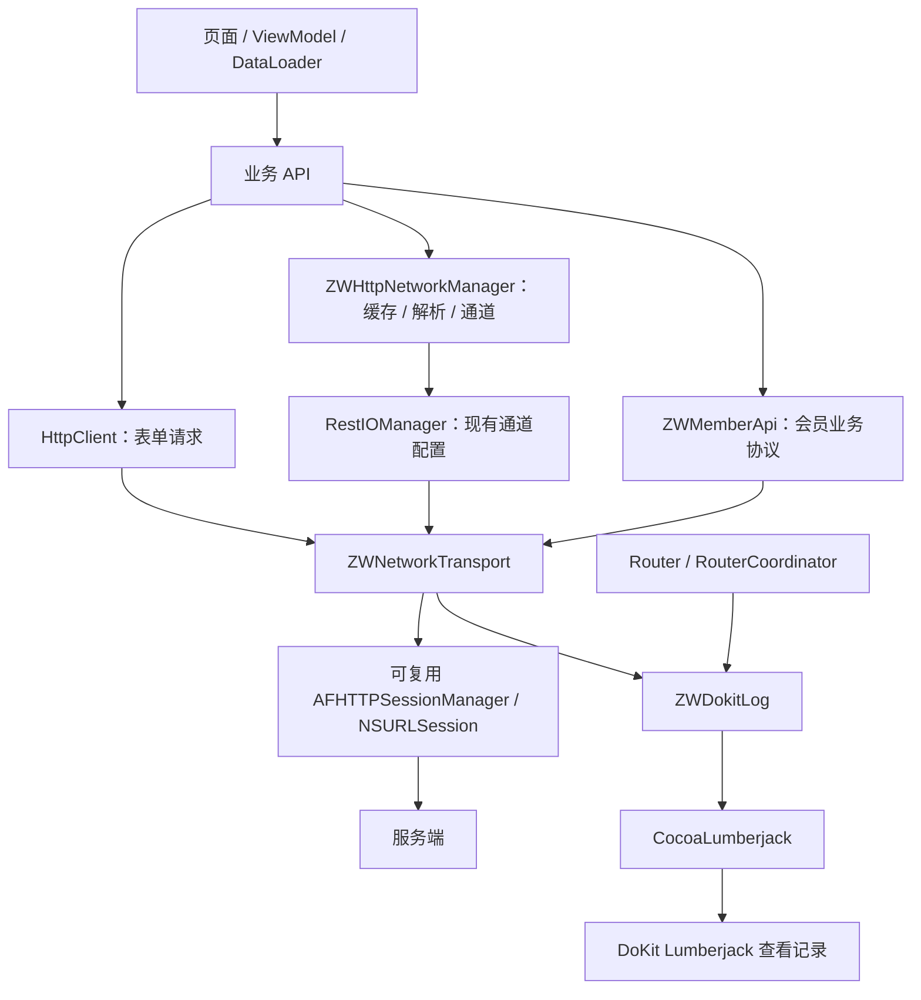

# 网络架构与 DoKit 调试日志

更新时间：2026-11-12。本次调整沿用现有 AFNetworking 依赖，抽出共用传输层，同时接入路由和网络诊断日志。

## 1. 原有问题与调整结果

- HttpClient 将每次请求的回调写入单例属性：移除共享回调属性，每个任务独立持有回调。
- HttpClient 只有 POST 使用日志包装，其他方法行为不一致：四种方法统一使用传输层。
- 取消请求操作的是 `operationQueue`，不是实际 URLSessionTask：改为查找、取消真实任务，同一个 key 的任务全部取消。
- 请求超时和缓存策略在请求生成后修改：请求生成前复制序列化器并设置，减少不同请求互相污染。
- Http2 修改共享响应序列化器：改为复制后配置，并串行化配置到任务创建过程。实际网络请求仍并发执行。
- 对临时 `defaultSessionConfiguration` 设置连接数没有作用：在创建真实 Session 时设置每个 host 最大连接数为 6。
- 缓存和网络解析中的错误曾被替换为 nil：现在向业务回传真实解析错误。
- 路由与请求日志不进入 Lumberjack：接入统一结构化日志出口。

## 2. 分层与请求流程



### 传输层

路径：`My_Study/Business/Common/Http/Transport/ZWNetworkTransport.h/.m`。

负责请求快照、发送任务、进度透传、取消、网络诊断及主线程完成回调。接受已有 SessionManager，因此现有 Http2 的通道和证书配置仍可以使用。

默认 Manager 复用 Session，返回原始 NSData，由业务解析。HTTP 非成功状态由 AFNetworking 产生错误，业务响应内容可能保存在错误的 `AFNetworkingOperationFailingURLResponseDataErrorKey` 中。

不自动弹 Toast，不将所有业务强制套成同一种成功码，也不自动重试 POST／PUT／DELETE。错误提示、鉴权恢复、业务成功码由业务 API 负责。

### 业务适配层

- `HttpClient`：保持原有调用形式和表单编码，返回值新增可取消的 `NSURLSessionDataTask`。删除无人使用的共享成功／失败回调属性，以及依赖可达性预判阻断请求的逻辑。
- `ZWHttpNetworkManager`：保留已有 DataLoader、缓存、JSON／XML／原始数据解析、multipart 及进度接口，传输经 RestIOManager 进入共用层。
- `ZWMemberApi`：保留 15 秒超时、JSON 请求体、Authorization、会员业务成功码解析和 HTTP 401 清理令牌行为，改用共用传输层。

项目中的图鉴等个别页面自建 Session、第三方 SDK 请求及 WebView 资源请求不在本次迁移范围内。它们不会自动获得本次 Network 日志。

`Http2` 是历史目录名称，不能据此判断每次请求实际采用 HTTP/2。具体协议由 URLSession 与服务端协商。

## 3. 调用与取消

原有业务调用可以继续使用：

```objc
NSURLSessionDataTask *task = [ZWM.http requestWithPath:@"/example/list"
                                             method:HttpRequestGet
                                        paramenters:@{@"page": @1}
                                     prepareExecute:nil
                                            success:^(NSURLSessionDataTask *task, id responseObject) {
    // HttpClient 返回原始数据，由业务按接口协议解析。
} failure:^(NSURLSessionDataTask *task, NSError *error) {
    // 按业务需要展示错误或处理取消。
}];

[task cancel];
```

HttpClient 构建请求失败时返回 nil，并在主线程回调失败。`prepareExecute` 在调用线程同步执行；需要更新 UI 的调用方应在主线程发起，完成回调统一回主线程。

Http2 仍支持 `cancelTaskWithKey:` 和 `cancelAllTask`，按 key 取消会取消同 key 下所有活动任务。取消后仍会收到取消错误，不会伪装成成功。

直接使用传输层时，可传入 taskKey；taskKey 在 resume 前写入 taskDescription。不要将 token 等敏感信息用作 taskKey。

## 4. DoKit 中查看日志

1. 使用启用 DoKit 的构建配置运行应用。
2. 打开 **DoKit → Lumberjack**，打开开关。
3. 回到业务页面，触发路由跳转或接口请求。
4. 回到 **Lumberjack → 查看记录**。
5. 根据 `[Router]`、`[Network]` 分类查看。每次网络请求结束后输出一条完整记录，requestId 用于区分并发请求。

Lumberjack 开关由 DoKit 自己持久化并控制。首次开启之前的日志不会自动补录；代码没有强制覆盖用户的开关设置，也没有修改 Pods 源码。查看记录页如未实时更新，可重新进入。

### 路由日志

每次跳转只输出一条“路由跳转”记录，成功提交、复用、拦截或失败结果合并在同一条中，不再单独打印请求开始与执行导航。模态日志表示已提交展示，不等待动画结束。

项目业务页面打开入口统一为 Router，个人中心和 TabBar 也进入同一日志链。未注册页面以 native/控制器类名标识；普通实例属性不会自动反射到入参日志，需要记录的业务标识应显式传入 routerParams。

主要字段：

- `path`：注册路径，不包含原始查询串。
- `target`：目标类。
- `type`：push／present／Tab／action 对应枚举值。
- `parameters`：合并后的路由入参。
- 失败事件包含错误域、错误码和说明。

结果中的“已提交 push／present”表示已经交给 UIKit，不能当成业务已经完成。Tab 通知直接应用选中状态，不额外发起第二次路由请求。

路径、目标、方式、结果分别占一行，入参使用缩进 JSON；这是同一条日志中的实际换行。在 Lumberjack 列表中点击记录展开后查看完整内容。

路由核心只提供 `eventLogger` 观察出口，由 ModuleContainer 连接 ZWDokitLog，避免核心代码直接依赖 DoKit。

### 网络日志

每次请求在完成、失败或取消后合并输出一条记录，不再单独输出请求开始日志。首行显示请求方法和 URL，展开后分段显示：

- 结果、requestId、HTTP 状态码和毫秒耗时。
- 请求头、Query 入参、Body 入参。
- 响应头和响应内容。
- 失败时的错误域和错误码。

耗时使用单调递增时间，不受设备时间调整影响。进行中的请求需要等待结束或超时后才出现完整日志。

二进制和流式请求体仅提供摘要，不读取上传流；大响应不完整展开。

日志示意：

```text
[Router] 请求跳转：path=member/manage/detail，parameters={memberId:123}
[Network] GET …/api/members/123
结果：请求完成
状态码：200
耗时：… ms
请求头：…
入参（Query）：…
入参（Body）：…
响应头：…
响应：…
```

路由输出为多行中文字段，入参为格式化 JSON；网络事件也使用换行缩进格式。

### 日志边界

- 在 `DEBUG` 或 `DOKIT` 构建中输出，普通发布构建不输出此次诊断日志。
- 密码、令牌、Authorization、Cookie、secret 等命名的字段递归脱敏。
- URL 查询中的敏感字段及 JSON param 内的敏感字段同步处理。
- 单个字符串、数组项数、字典项数、嵌套层数、数据体和最终单条输出均设上限。
- 未识别的对象打印类型摘要，不反射展开业务对象。
- 脱敏基于字段命名，不是任意自由文本的敏感信息识别。调试日志仍应仅用于受控开发环境。
- DoKit 自身的总日志缓存与查看界面沿用其现有实现；本次没有新增无上限的自建日志缓存。

## 5. 安全与行为变化

自定义证书通道现在保留公钥绑定和域名校验，同时设置 `allowInvalidCertificates = NO`。过期、自签或系统不信任的证书可能因此被拒绝，需要在对应测试环境验证证书链。

网络错误不再由 HttpClient／Http2 统一自动弹 Toast，由业务决定提示。会员 API 保留自身错误消息映射。

本次没有加入统一 token 刷新、多请求等待刷新、自动重试队列或新的业务缓存。它们需要明确业务协议后单独设计，不能由传输层猜测。

## 6. 验证记录

`tests/ZWNetworkTransportTests.m` 使用真实 AFNetworking 和自定义 NSURLProtocol，在本机拦截测试地址，不访问真实服务。覆盖四种方法的并发回调隔离、请求快照、主线程回调、HTTP 500、同 key 多任务取消、嵌套／URL 脱敏和大数据摘要，共 20 项检查。

运行：

```bash
python3 "tests/run_network_tests.py"
```

脚本将编译和执行限制在 40 秒、10 秒内，二进制使用临时目录，不写入业务目录。

路由核心回归测试新增了路径、入参和失败日志观察检查，共 20 项通过；本次 9 个修改的实现文件通过 iOS 源码语法检查。语法检查不等于完整链接或 UI 验证；完整 Xcode 编译、接口联调和 DoKit 入口展示仍由维护者验证。

重点回归：会员登录与 401、列表／详情、GET／POST／PUT／DELETE、缓存优先和仅缓存、上传进度、按 key 取消、快速并发请求、证书通道，以及 Lumberjack 开关开启后的 Router／Network 记录。


## 7. 路由日志展示示例

```text
[Router] member/manage/detail
结果：已提交 push
方式：push
路径：member/manage/detail
目标页面：ZWMemberDetailViewController
入参：
{
  "memberId" : 123
}
```

失败时仍为一条记录，追加说明、错误域和错误码。敏感字段脱敏和体积上限保持生效。

本轮回归：路由核心 24 项、网络与日志格式 24 项检查通过，覆盖成功／拦截／解析失败单条记录、改写目标及多行入参格式。

路由日志首行直接展示实际 path，便于在折叠列表中识别目标；路径为空时回退为事件名称。

网络日志合并后的格式回归检查已覆盖首行、请求头、入参、响应、状态、耗时和脱敏。

## 8. 主 API 地址配置

废弃的 Apifox／Postman Mock 地址已清理。主 API 改为构建环境注入、统一 URL 校验与拼接。当前各环境留空，待有后台时填写；配置缺失会明确失败，不会发送到旧地址。见 [请求域名与环境配置](请求域名与环境配置.md)。
