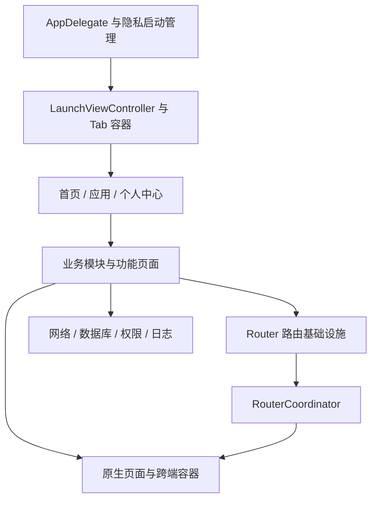
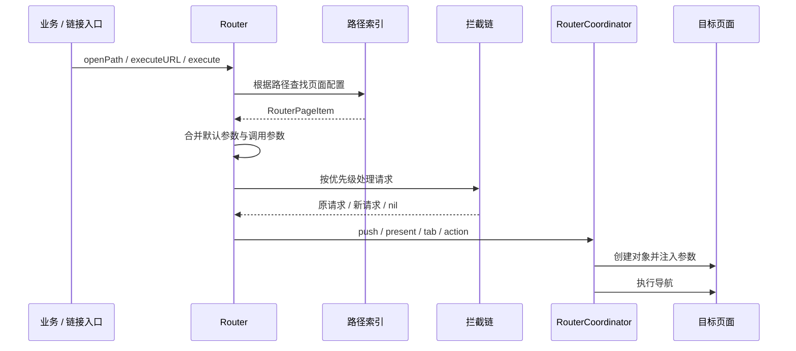

# My_Study_New 项目架构与路由设计

更新时间：2026-11-12。本文以当前源码为准，覆盖应用结构、本次路由调整、接入方式和验证边界。

## 1. 项目定位与架构现状

项目以 Objective-C、UIKit 为主体，包含 Swift 代码、Flutter 接入代码和多类业务／技术演示页面，通过 CocoaPods 管理主要 iOS 依赖。

当前属于按目录划分职责的单体工程。业务代码仍在主工程中编译，并非各业务已经拆成独立 Pod 或 Swift Package。项目内同时存在 MVC、MVVM、MVP 和响应式实践，不能将整个项目统一描述为某一种页面架构。

主要应用 Target 为 `My_Study`、`My_Study_Sit`、`My_Study_Uat`，另有通知扩展和 Live Activity 相关目录。日常开发打开 `My_Study.xcworkspace`。



### 主要目录

| 目录 | 当前职责 |
| --- | --- |
| `My_Study/AppDelegate.*` | 系统事件入口、窗口创建和启动协调 |
| `My_Study/LaunchViewController.*` | 应用根容器相关逻辑 |
| `My_Study/TabsIndexVc/` | 首页、应用页、个人中心及入口配置 |
| `My_Study/Business/` | 会员、相机、宝宝时光、设置、登录、权限、隐私等业务 |
| `My_Study/Business/Module/` | 全局服务容器，以及日志等模块 |
| `My_Study/Business/Common/Http/` | 网络基础能力 |
| `My_Study/Router/router/` | 注册表、请求、解析、拦截、导航执行 |
| `My_Study/Router/SchemeProtocols/` | 现有协议与路径定义；新增页面统一在路由注册表接入 |
| `My_Study/Base/` | 基础控制器、Tab／导航／Web 容器等 |
| `My_Study/Category/` | UIKit、Foundation 等扩展 |
| `My_Study/DevelopMentLibrary/`、`BaseLib/`、`PublicComponent/` | 历史基础库与公共组件，存在职责交叉 |
| `My_Study/FlutterSection/` | Flutter 容器及桥接代码 |
| `My_Study/Configuration/`、`Source/` | 配置与本地资源 |
| `tests/` | 独立测试源码与人工验证记录 |
| `ThirdParty/`、`LocalPodsLib/`、`DXSDK/` | 第三方代码和本地依赖 |

### 启动与隐私边界

1. `AppDelegate` 创建窗口、设置主题。
2. 调用 `ModuleContainer.registerRouter`，使隐私展示期间的页面路由可用。
3. 由 `ZWPrivacyPolicyManager` 继续组织启动流程。
4. 用户同意隐私协议后，`startServicesAfterPrivacyConsentWithLaunchOptions:` 调用 `registerConfig`，配置数据库、日志、权限、地图及相关 SDK。
5. `registerRouter` 已改为幂等，后续调用 `registerConfig` 不再替换原路由实例。

新增路由注册不应顺带启动定位、登录请求或其他依赖隐私授权的服务。

## 2. 路由架构与职责

本次采用“索引注册表 + 路由请求 + 拦截链 + UIKit Coordinator”的职责划分，保留 `ZWM.router` 作为统一入口。

这里的 Coordinator 是通用导航执行器。当前尚未实现每个业务独立的流程 Coordinator，也尚未形成完整的编译期类型安全路由体系。



### 文件分工

- `RouterPageConfig`：内置路由常量和页面注册配置，包含首页功能注册。
- `RouterPageItem`：单条注册描述，包含路径、目标类名、导航类型和默认参数。
- `RouterParam`：一次请求，包含原始路径、目标类、参数、弱引用上下文与业务回调。
- `Router`：维护路径和类名索引、解析参数、执行拦截链、将导航调度到主线程。
- `BaseRouterIntercept`：同步拦截器基类。返回请求表示继续，返回新请求表示改写，返回 `nil` 表示终止。
- `RouterNavigateDelegate`：导航执行协议。
- `RouterCoordinator`：解析 UIKit 上下文、创建页面、注入参数、执行页面跳转与行为调用。
- `Router+CRM`：保留现有调用入口，统一委托核心编解码，处理 App 唤起链接。
- `ModuleContainer`：组装 Router 和 Coordinator，保留 `/h5/` 动态页面解析。
- `NSObject+Params`：将路由请求与参数关联到目标对象。

### 查找性能与线程约定

注册时一次构建路径索引和类名索引，时间与空间复杂度均为 O(n)。已注册原生路径、类名反查平均为 O(1)，替代原有逐条遍历。

解析 URL 的开销随 URL 长度和参数体积增长；导航本身仍由 UIKit 决定耗时。当前未提供性能基准数据，不能据此宣称整体页面打开速度提升了固定比例。

- 注册表通过同步锁发布，注册失败保留原索引。
- 注册时复制页面配置，避免原配置对象后续修改影响索引。
- 拦截器设置时完成优先级排序，跳转时不重复排序。
- 导航、拦截与 URL 执行在主线程执行。
- 应在启动阶段完成注册和拦截器配置；不建议在业务运行中频繁改写全局注册表。
- 大对象、图片、二进制数据不应塞进 URL；内部调用优先直接传字典。

`pageForPath:`、`pageForClassName:` 返回的注册项应视为只读，不应由业务修改。

## 3. 调用方式

### App 内打开注册页面

```objc
#import "ModuleContainer.h"

[ZWM.router openPath:ZWRouterPageMemberDetail
         parameters:@{@"memberId": @123}
            context:self
            success:nil
            failure:^(NSError *error) {
    NSLog(@"打开会员详情失败：%@", error.localizedDescription);
}];
```

参数合并顺序为：注册默认参数 → 路径中已有参数 → 显式传入参数。后面的同名值覆盖前面的值。

建议业务传入 `context:self`，使跳转固定发生在当前窗口。`RouterParam.context` 为弱引用；异步执行前页面已释放时，不保证继续使用原上下文。

### URL 调用与参数编码

```objc
NSString *url = [Router encodeRoute:ZWRouterPageMemberDetail
                        parameters:@{@"memberId": @123}];
[ZWM.router executeURL:url success:nil fail:^(NSError *error) {
    NSLog(@"路由失败：%@", error.localizedDescription);
}];
```

支持 `path?param=<百分号编码的 JSON 对象>` 和普通查询参数。先按查询边界拆分，再对各字段解码，避免 `&`、`?`、`%`、中文等内容破坏参数边界。JSON 参数必须是字典，数组、`null`、无效编码会被拒绝。

`encodeRouterUrl:params:`、`decodeRouterUrl:` 已委托同一套核心编解码实现，避免两套规则漂移。

### 成功与失败回调

`success` 是业务结果回调，例如选择页返回选中项；它不表示 push 动画结束。目标业务通过 `self.routerParamObject.successBlock` 返回结果。

`failure` 用于解析、拦截、导航器缺失、目标类无效或导航上下文不可用等失败。调用方应根据业务展示提示，核心路由不统一弹窗。

重复打开栈顶同一路由且参数相同的请求会直接复用；不会为复用请求自动触发业务成功回调。

### 模态、Tab 和行为

`RouterTypeNavigate` 执行 push；`RouterTypeNavigatePresent` 使用导航容器执行模态展示；`RouterTypeNavigateTab` 发送现有 Tab 切换通知；`RouterTypeAction` 实例化 `BaseRouterAction` 子类并执行。

模态展示从解析到的可见控制器发起，修复此前依赖 `currentViewController.navigationController` 导致的无导航容器展示失败。

现有页面常量参数 `ss_constantParams`、`extra~xxxx.anim` 和 `modalPresentationStyle` 继续生效。

## 4. 页面接入步骤

1. 定义稳定的业务路径，避免将控制器类名暴露为业务协议。
2. 在 `RouterPageConfig.h/.m` 增加常量和注册项。
3. 为页面声明参数要求，在页面或业务入口显式校验；不要通过任意 KVC 批量注入属性。
4. 调用 `openPath:parameters:context:success:failure:`。
5. 补充正常、缺参、重复点击和返回流程验证。

```objc
// 注册示例。
[RouterPageItem makeWithUrl:@"order/detail"
                   clsName:@"OrderDetailViewController"
                      type:RouterTypeNavigate
               attachValue:@{@"hidesBottomBarWhenPushed": @YES}];
```

页面读取参数：

```objc
#import "NSObject+Params.h"

NSNumber *orderID = self.routerParams[@"orderId"];
if (![orderID isKindOfClass:NSNumber.class] || orderID.integerValue <= 0) {
    // 由业务展示无效参数状态或通过失败回调结束流程。
    return;
}
```

当前会员详情已接入 `member/manage/detail`，由导航器检查 `memberId` 为正数，页面在加载时读取该值。该检查仍是业务特例，后续新增大量带参页面时，应将校验升级为各模块的请求对象或注册验证器。

### 接入拦截器

```objc
@interface BusinessRouterIntercept : BaseRouterIntercept
@end

@implementation BusinessRouterIntercept
- (NSInteger)interceptPriority { return 100; }

- (RouterParam *)doIntercept:(RouterParam *)request {
    return request;
}
@end

ZWM.router.interceptors = @[[BusinessRouterIntercept new]];
```

优先级数值越小越先执行。当前是同步链，不能在这里发起登录后立即返回请求。异步登录、取消和恢复原请求需要业务流程专门协调，当前尚未统一实现。

## 5. 导航上下文与重复跳转

- 显式上下文优先，沿导航容器、Tab、模态关系查找可见页面。
- 无上下文时优先使用唯一前台活跃场景的主窗口。
- 存在多个活跃场景而没有明确上下文时拒绝跳转，避免跨窗口误操作。
- 当前页面正在展示、关闭或存在转场协调器时拒绝新跳转。
- 栈顶页面的目标类与参数相同时复用现有页面。
- 请求持有上下文为弱引用，减少页面 → 请求 → 页面形成循环引用的风险。

这是一套防重复与转场保护机制，尚未实现导航队列。转场期间失败的请求不会自动等待或重试。

## 6. 外部链接与跨端边界

`Router+CRM` 使用 `NSURLComponents` 解析外部链接，精确匹配 scheme、host、port 和 App 入口路径，拒绝带用户名／密码的来源及重复 `param` 参数。链接中的业务路径必须已注册，行为路由禁止经此外部入口调用。

当前代码的示例域名为 `https://zw.home.cn`，App 入口为 `zwapp://zw.app/open`。这不代表 Associated Domains、AASA、线上域名和系统回调已经端到端验证。

本次没有为每条已注册页面增加独立外部访问权限，外部页面白名单仍需按业务敏感程度进一步收紧。

`/h5/` 动态解析仍由 `ModuleContainer` 提供；Flutter 容器注册为 `flutter/container`。Flutter 内部页面栈、H5 自身路由、第三方控制器的内部导航没有被本次改成原生 Router。

## 7. 本次调整范围

已调整：

- 建立路径与类名索引，拒绝重复注册。
- 修复短视频与 RunLoop 路径冲突，短视频路径为 `test/shortVideo/page`。
- 统一 JSON／URL 编解码与参数合并。
- 修复拦截结果未生效问题，支持改写与终止。
- 将 UIKit 导航执行从 `ModuleContainer` 拆入 `RouterCoordinator`。
- 增加主线程调度、弱上下文、转场保护和栈顶重复请求复用。
- 调整首页已注册功能、Flutter 容器、应用页 RunLoop 入口及会员详情入口。
- 将 Coordinator 源文件加入三个主要应用 Target。

尚未统一的部分：

- 页面打开入口已统一为 Router；返回、dismiss、导航栈重建和子控制器切换仍保留现有 UIKit 实现。
- 内部支持注册路径和预配置控制器实例两种入口，尚未建立各业务独立的强类型请求协议。
- 尚未按独立编译模块拆分注册，也未提供业务级 Coordinator 树。
- 尚未提供统一异步登录拦截、权限恢复、导航队列、路由埋点和结果取消模型。
- `RouterLifeCycleDelegate` 仍是历史空协议，当前不应依赖其接收生命周期事件。
- 页面名统计等历史辅助代码仍有遍历注册配置的实现；它不处于主要导航查找路径。

后续建议先按“会员／登录／订单”等业务抽出模块请求与流程，再逐步迁移历史入口。每个模块独立负责参数契约和结果，上层 Router 只分发请求。

## 8. 验证记录与编译检查

`tests/RouterCoreTests.m` 是不依赖 UIKit 的独立 Foundation 可执行测试，不属于已接入 Scheme 的 XCTest Target。

已执行核心验证，共 17 项检查通过，覆盖：注册与重复注册、未知路径、非法 JSON、特殊字符往返、默认参数合并、拦截替换／终止、失败回调、缺失导航器和后台调度至主线程。

复现命令，在 `My_Study_New` 目录运行：

```bash
xcrun clang -fobjc-arc -fblocks -framework Foundation \
  -I "My_Study/Router/router" \
  "tests/RouterCoreTests.m" \
  "My_Study/Router/router/Router.m" \
  "My_Study/Router/router/RouterParam.m" \
  "My_Study/Router/router/RouterPageItem.m" \
  "My_Study/Router/router/BaseRouterIntercept.m" \
  -o "/private/tmp/my-study-router-tests"

"/private/tmp/my-study-router-tests"
```

完整 iOS 构建尚未确认通过，最终编译与 UI 验证由项目维护者进行。此前增量编译发现 `displayViewController:ignorePresent:` 缺少公开声明，现已补齐；补齐后的整包构建未再次执行。

建议在 Xcode 中检查：

- 三个应用 Target 均包含 `RouterCoordinator.m`，无重复编译项。
- 首次安装隐私页及同意后的启动流程正常。
- 首页美颜相机、宝宝时光、网页、Flutter 容器正常打开和返回。
- 会员列表到详情，合法 ID、非法 ID、返回和业务登录流程正常。
- 短视频和 RunLoop 分别进入正确页面。
- push、present、Tab 切换及现有选择页业务回调正常。
- 快速连点、转场中跳转、无导航容器和后台来源请求行为符合预期。
- 外部链接的合法来源、伪造域名、错误参数及未注册路径均得到正确处理。

本次没有提交或推送 Git 代码。

## 9. 后续网络与日志调整

路由已通过 `eventLogger` 接入 DoKit Lumberjack，网络链路已抽出共用传输层。实现说明、查看步骤、行为变化和测试方法见 [网络架构与调试日志](网络架构与调试日志.md)。本文前述“尚未提供路由埋点”指业务统计体系；当前已补充开发诊断日志。


## 10. 全量页面入口与 TabBar 日志补齐

个人中心等历史入口直接调用 UIKit，无法经过 Router 的日志与拦截链。本次将项目业务源码中的 103 处 push／present 调用统一改为 Router 入口，涵盖 42 个文件，包括个人中心、设置、小游戏、图鉴、宝宝时光、相机、弹窗及抽屉桥接。没有通过全局方法交换监听 UIKit。

### 预配置实例入口

```objc
UIViewController *page = [SettingViewController futureReminderViewController];
[Router pushViewController:page
     navigationController:self.navigationController
                 animated:YES];

[Router presentViewController:page from:self animated:YES completion:^{
    // 保留原有展示完成逻辑。
}];
```

这两个入口同样执行 `Router.execute → 拦截链 → RouterCoordinator → UIKit`。使用已有实例，保留工厂方法、属性、代理、自定义转场和模态样式；实例式 present 不强制额外包装导航控制器。

注册页面优先输出注册 path，例如 `personal/reminders`、`games/home`、`games/nearby-drawing`、`atlas/digimon`。未注册的实例页面以 `native/控制器类名` 作为内部诊断路径。它不是外部链接白名单，不允许通过外部 URL 任意实例化类。

实例已有的 `routerParams` 会合并进入请求及日志；原先通过普通属性或构造器传入的业务对象继续保留在实例中，不会反射读取全部属性用于打印。需要观察的业务标识应显式设置，例如：

```objc
page.routerParams = @{@"recordId": @123};
[Router pushViewController:page navigationController:self.navigationController animated:YES];
```

请求仅在导航前临时持有目标实例。执行器在页面关联请求前清空目标引用，避免“页面持有请求、请求再持有页面”形成循环引用。业务回调继续保留。

### TabBar

`ZWTabBarController` 的用户点击、`selectedIndex` 和 `selectedViewController` 修改统一转换为 Tab 路由请求。执行器通过 `applySelectedIndexFromRouter:` 应用选中状态，内部不会再次提交路由请求。

日志包含目标 Tab path、`fromIndex`、`toIndex` 和 `source`（tap／programmatic）。完成事件为“Tab 切换完成”。原有通知切换入口仍进入同一链路；匹配方式改为精确路径匹配，防止相似前缀误选 Tab。

### 架构检查

```bash
python3 "tests/check_route_entries.py"
```

该检查扫描业务 Objective-C 实现，跳过注释与字符串，禁止在 RouterCoordinator 之外新增直接 UIKit push／present 调用；基础类中转发至 super 的覆盖方法不受此限制。当前扫描 605 个实现文件通过。

本次 47 个可用依赖下的修改实现文件通过 iOS 语法检查；另一个修改文件 `FlutterSection/MyFlutterRouter.m` 未加入三个应用 Target，当前也缺少 FlutterBoost 依赖，未能独立完成语法检查。没有为解决该历史未启用模块而安装或改动依赖。

该检查范围是页面打开与 Tab 切换。返回、dismiss、系统内部跳转及第三方 SDK 内部行为不等同于已经进入 Router。完整 UI 行为仍需运行回归。


## 11. 路由日志合并

每次跳转仅保留一条最终诊断记录，包含方式、路径、目标、入参及结果。请求开始、执行和模态完成不再分别输出。Tab 通知在接收端直接应用选中状态，避免重新提交路由造成重复日志。

字段使用实际换行，入参使用缩进 JSON。在 Lumberjack 中点击记录展开查看。详细示例见 [网络架构与调试日志](网络架构与调试日志.md)。
